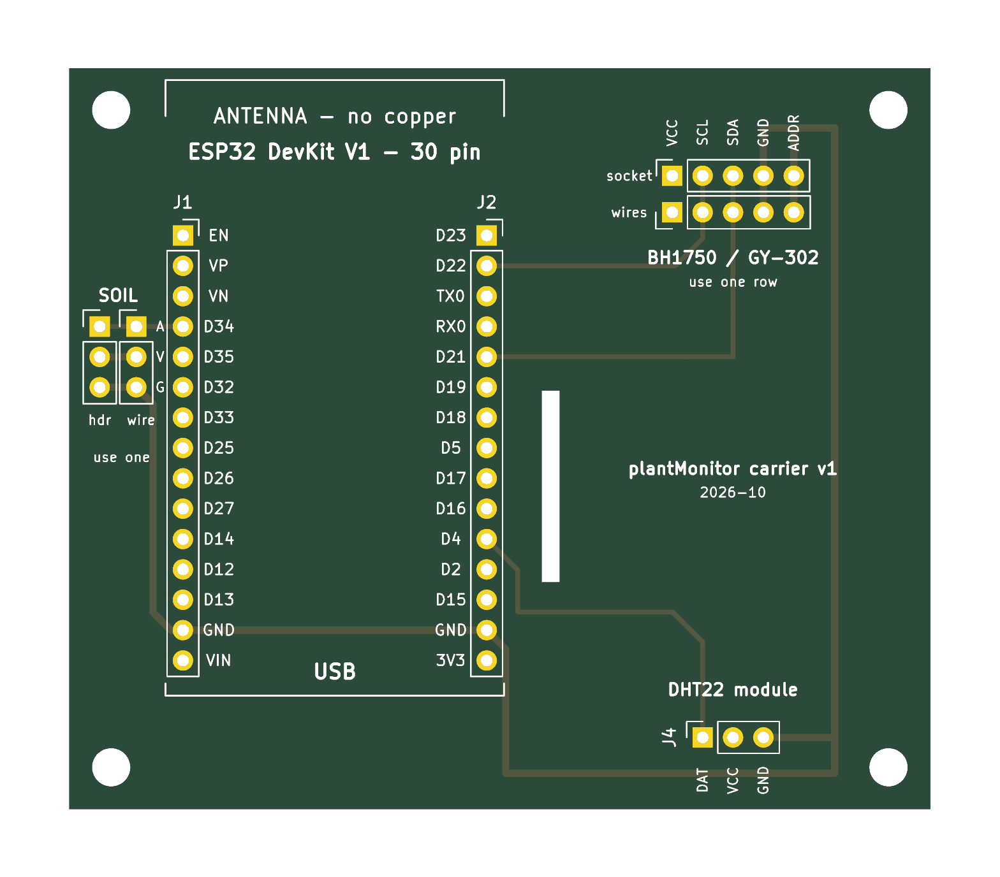

# Sensor carrier board

A 72 × 62 mm two-layer board that holds one sensor node. Everything plugs in, so any part can be swapped:

- **ESP32 DevKit V1 (30 pin)** plugs into two 15-pin female sockets.
- **BH1750 (GY-302)**, top right: two parallel rows, use one. The upper row (J3) takes a 5-pin socket or header; the lower row (J7) is solder holes for wires (1.0 mm, fits 22–24 AWG), to place the light sensor elsewhere.
- **DHT22 module (3 pin)** plugs into a 3-pin female socket, bottom right. A slot in the board keeps the ESP32's heat away from it.
- **HW-390 soil sensor** connects to a 3-pin header (for the sensor's cable) **or** to 3 solder holes (for wires soldered directly). Use one or the other.

The copper follows the firmware's pins: DHT22 → D4, SDA → D21, SCL → D22, soil → D34, plus 3V3 and GND. The BH1750's ADDR pin is tied to GND (I²C address 0x23). There is no copper under the ESP32 antenna.



## Check before ordering

The board matches these parts (confirmed against the real modules). If you use a different module, check it first:

| Part | Board expects |
|---|---|
| ESP32 DevKit V1, 30 pin | Pin rows **25.4 mm** apart (`ROW_SPACING` in `generate_pcb.py`). Antenna up: left EN…VIN, right D23…3V3 (D17/D16 are also called TX2/RX2). |
| DHT22 module | **DAT VCC GND**, left to right |
| BH1750 (GY-302) | **VCC SCL SDA GND ADDR** (SDA may be printed as DAT) |
| HW-390 soil sensor | **AOUT VCC GND** (A V G on the board) |

Each module lies flat above the board. Plug it in so its pin labels match the board's; depending on the module, it may stick out over the board's edge.

## Ordering (JLCPCB, PCBWay, …)

Upload `plant-carrier-gerbers.zip`. The defaults are fine:

| Setting | Value |
|---|---|
| Layers | 2 |
| Thickness | 1.6 mm |
| Min track / clearance | 0.4 mm / 0.2 mm (any standard service) |
| Holes | 1.0 mm plated, 3.2 mm non-plated (M3) |
| Surface finish | HASL (lead-free if you prefer) |

The board contains one internal slot (1.5 × 16 mm); the fab mills it automatically from the Edge.Cuts layer.

## Parts to solder

| Ref | Part | Qty |
|---|---|---|
| J1, J2 | Female pin socket 1×15, 2.54 mm | 2 |
| J3 | Female pin socket 1×5, 2.54 mm (BH1750 plugged in), **or** solder 5 wires into J7 | 1 |
| J4 | Female pin socket 1×3, 2.54 mm | 1 |
| J5 | Male pin header 1×3, 2.54 mm (soil cable), **or** solder wires into J6 | 1 |
| H1–H4 | M3 spacers/standoffs (optional) | 4 |

Break the sockets from long female header strips. A tip for straight sockets: plug them onto the ESP32's pins first, put the whole thing into the board, then solder. The sockets then line up exactly.

## Regenerating

The board is generated from `generate_pcb.py` (KiCad 9 Python API). After a change:

```sh
cd hardware/pcb
python3 generate_pcb.py
kicad-cli pcb drc --severity-all -o drc.rpt plant-carrier.kicad_pcb   # expect 0 errors, 0 unconnected
kicad-cli pcb render --side top -o render/top.png plant-carrier.kicad_pcb
rm -rf fab && mkdir fab
kicad-cli pcb export gerbers --layers F.Cu,B.Cu,F.Mask,B.Mask,F.Silkscreen,B.Silkscreen,F.Paste,Edge.Cuts --no-protel-ext -o fab/ plant-carrier.kicad_pcb
kicad-cli pcb export drill --excellon-separate-th -o fab/ plant-carrier.kicad_pcb
(cd fab && rm -f ../plant-carrier-gerbers.zip && zip -q ../plant-carrier-gerbers.zip *)
```

The DRC reports two expected warnings: the soil header and solder holes (J5/J6) and the light sensor socket and solder holes (J3/J7) have overlapping courtyards, because only one of each pair is used.

You can also open `plant-carrier.kicad_pcb` in KiCad and edit it by hand. The script overwrites it the next time it runs, though.
